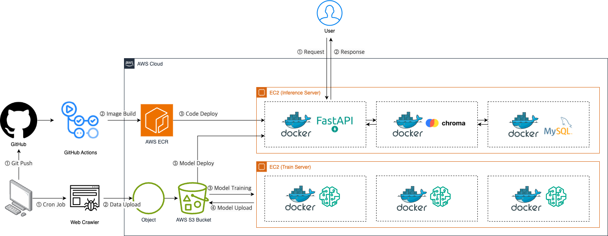

# capstone-api

커뮤니티 서비스에 적용 가능한 다음 기능들을 통합 제공하는 API입니다.

- **유사 게시글 추천** : [🔗 GitHub 바로가기](https://github.com/seungminki/capstone-similarity-model.git) <br>
- **유해 게시글 필터링** : [🔗 GitHub 바로가기](https://github.com/seungminki/capstone-filter-model.git) <br>
- **자동 주제 태깅**: [🔗 GitHub 바로가기](https://github.com/seungminki/capstone-classification-model.git) <br>


빠르게 변화하는 커뮤니티 언어 환경에 적응할 수 있도록, 전체 구조를 **자동화된 파이프라인**으로 구성하였습니다. <br>
**GitHub Actions**를 활용하여 주기적인 모델 업데이트 및 배포 자동화를 구현하였습니다.



## Get started MySQL
```
$ docker pull mysql:8
$ docker run -d -p 3306:3306 --name mysql-db -t mysql:8
```

## Directory structure
```
├── .github/workflows
│   └── deploy-ec2.yaml
├── app
│   ├── routers
│   │   ├── classify.py
│   │   ├── filter.py
│   │   └── similar.py
│   ├── main.py
│   ├── preprocess.py
│   └── schemas.py
├── utils
│   ├── bert_util.py
│   ├── chroma_util.py
│   ├── embedding_util.py
│   ├── mysql_util.py
│   ├── openai_util.py
│   └── s3_util.py
├── __init__.py
├── .gitignore
├── Dockerfile
├── requirements.txt
└── README.md
